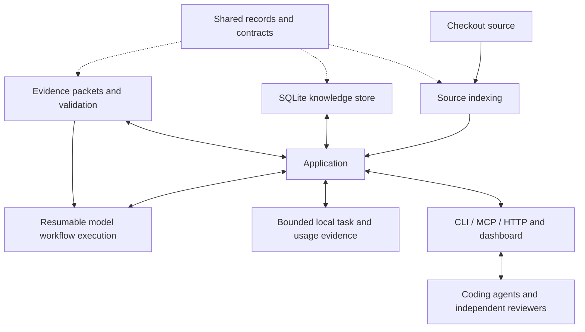

# AnaxiGraph V2 architecture

Help people and coding agents write better code, make sound architecture decisions, and leave the
next change straightforward.

## Selected direction — 25 October 2026

The maintainer selected a clean replacement in the standalone checkout `~/repos/anaxigraph-v2`.
Its Git history was extracted from the initial nested prototype on 25 October. This supersedes the
24 October recommendation to freeze all existing capabilities before comparing implementation
routes. Existing features are candidates, not mandatory migration obligations. Build the useful
minimum first and add features selectively. Fresh Eyes and pattern discovery remain core ideas.

The existing 0.9.1 implementation remains available separately. V2 imports none of its runtime.
The only copied product data is a compact selection of the existing 133 pattern cards; their old
scoring, planning and execution engines were not copied. The Apache license is retained. The
dashboard borrows visual direction, with a new small implementation.

## Eight components and one application

| Component | Provides | Must not own |
| --- | --- | --- |
| `contracts.py` | Immutable snapshot, node, edge and graph records | SQL, frameworks, source parsing or workflows |
| `indexing/` | `index(root) -> Graph`, incremental snapshot/source capture and bounded local Git history | Executing analyzed code, generating semantic prose or saving results |
| `storage/` | Atomic graph publication, canonical annotations, source indexes and bounded reviews | Architectural judgment, source parsing or provider execution |
| `analysis/` | Source/behavior evidence packets, complete-result validation and bounded guidance | SQL, UI, model-provider state or reading project files |
| `application/` | Shared facade, review operations and portable exchange; guard source/context identity and publish validated results | A separate store, parser, provider engine or transport-specific reasoning |
| `workflows/` | Durable batch scheduling, bounded provider execution, ordered review passes and retries | Source indexing, SQL, architectural reasoning outside the analysis contract |
| `evidence/` | Bounded local task, consultation, outcome and provider-usage records | Architectural reasoning, raw prompts/source, external telemetry or invented costs |
| `interfaces/` | CLI, MCP tools, HTTP and dashboard over the same application | Independent ownership inference or analysis state |
| `recorder/` | A pytest lifecycle plugin and shared file audit, with an optional direct-Python-child bootstrap and bounded receipts | Imports from other AnaxiGraph components; dependencies beyond the standard library and pytest (only in the parent) |

These are logical Python packages with explicit records and functions, installed together. Separate
distributions, services and plugin systems would add deployment work without helping this milestone.
The boundary tests make their dependency direction executable. Interfaces can evolve behind these
contracts without forcing their callers to know internal implementations.

## First milestone

1. Scan a checkout into a useful structural graph without a model call.
2. Inspect modules/functions, dependencies, consumers and observed test links.
3. Prepare a change using lexical/symbol/capability evidence; assess proposed file placement.
4. Pin a change baseline at preparation and compare subsequent candidates against it; attribute
   supplied check reports to the exact candidate.
5. Generate an annotation task with every supplied function and accept only complete results.
6. Cheaply screen catalogue IDs for production modules, then judge only shortlisted opportunities
   with ratings, costs, simpler alternatives and evidence. Retain exhaustive review as an opt-in.
7. Generate a behavior-only Fresh Eyes task retaining three independently described alternatives,
   complete declared requirement coverage, tradeoffs and high-level Mermaid diagrams.
8. Explore the same saved understanding through a sortable table, focused graph and review workflow.

The first milestone's external-agent request/submit interface remains available. The next selected
capability is an internal model runner: choose a provider/model per stage, independent parallel
batches, optional stronger fallbacks and ordered review passes. Each request is saved before work
starts. Accepted batches commit immediately. Run progress retains identities and status, rather than
another copy of source/results. Interrupted runs retry unfinished work; compatible accepted results
are reused only for the requested pipeline. Final reconciliation verifies module/catalogue coverage
or the blind product hierarchy. It is not an extra unverified claim that a review happened.

The [27 October focused-review decision](change-request-focused-reviews.md) sharpens this architecture:
a ten-principle charter favors explicit ownership, small public contracts and independently testable
components. Structural public-surface, private-reference, cycle and test-link observations inform
advice. Narrow Luna tasks map concisely and select plausible catalogue IDs; a stronger model judges
only those selections. Tests and inert markers remain mapped but leave the default pattern scope.
Screening is not evidence that every unselected pattern is irrelevant. Source-aware judgments remain
proposals, and required project checks remain authoritative. Existing explicit model profiles and
exhaustive results are preserved. Fresh Eyes stays independently requested.

The [component architecture principles](component-architecture-principles.md) define the intended
unit of independent development and verification: a cohesive component behind published behavioral
contracts, usually composed in process. Shared schemas, mutable state, configuration and infrastructure
can extend a change's scope even when signatures stay stable. Current guidance states these rules;
the bounded two-level reference neighborhood and observed test links are not a verified CI plan.
The [CI/CD workflow](change-request-ci-delivery.md) reads real pipeline declarations for review.
The declared-input planner that came with it selected component checks from an authored task
policy; it was retired from the product in November 2026 and lives in `experiments/declared_ci/`,
because no project in its trials authored that policy. The supplied-evidence audit and gate also live with that experiment. Ordinary validation
attributes check receipts; the experiment applies selector qualification externally. Which tests
a change needs is now answered from a recorded run (see `tests_for_change` below). Accepted component-rule editing remains
proposed work.
The [architecture scouts](change-request-architecture-scouts.md) now perform focused source-aware
searches, compare local/workspace/separate-repository package options, feed task guidance and
require dispositions for material plan findings. Detailed Pattern findings use the same decision
and followthrough path. IDs bind the review and full finding content: reordering preserves them,
while changed advice needs a fresh decision. Preparation keeps
the highest-priority proposals across both kinds; recent blind reviews cannot displace them.
They reuse the shared runner and do not alter
Fresh Eyes isolation. New Pattern runs also include a separate repository-level delivery specialist;
CI-only reviews need neither semantic annotations nor a Python application. The model proposes
pipeline improvements. Both operate through the shared application and runner.

Screening, Pattern detail and architecture workers receive fingerprint-verified source for their
exact module scope. The application captures it; the runner delivers it within the input budget.
Review requests persist the source fingerprints rather than those additional source copies, so
body changes invalidate results and compatible clone imports can reuse them. Annotation requests
still carry their original source payload. Fresh Eyes receives neither implementation evidence nor
the source-aware envelope. Supplying code enables implementation critique; it does not establish
recommendation quality.

Annotation validity includes its own source and public interfaces of resolved outgoing dependencies.
Comment and body-only dependency edits preserve callers; changed signatures, documentation and
exports invalidate them. A separate implementation-change flag preserves behavioral uncertainty;
interface freshness never establishes behavior preservation.
An annotation contract version also controls reuse. This is not a guarantee of
complete dynamic-call invalidation. Stored annotations distinguish agent interpretations from
source observations; contracts distinguish declared evidence from inference. Reviews remain proposals.

## Fresh Eyes isolation

The returned blind request contains opaque requirement IDs, behavior statements, the source-independent
charter and the response contract. Source, module identities, symbols, dependency topology and prior recommendations are
excluded. Module IDs, source paths and code-shaped identities such as snake_case, CamelCase,
dotted/backticked names and calls are rejected. Ordinary English words remain usable. Functional statements
still require judgment: the validator cannot prove a sentence contains no conceptual implementation
assumption, that all product requirements were extracted, or that three descriptions are genuinely
different architectures.

Internal workers start in fresh temporary directories with tools, MCP connections, source rules and
prior sessions disabled. Give only the blind packet to an external worker without repository/source
tools; the server cannot sandbox an independently supplied agent's filesystem. Source-aware assessment of a
frozen alternative must remain a separate operation. Each level retains three alternatives rather
than declaring one tested or best. Subsystems produce behavior-only functional briefs with explicit
input-requirement attribution. Recursive groups of up to sixteen briefs feed independent product
designs. Final alternatives cover these product requirements without thousands of source IDs.
Coverage is checked mechanically; semantic preservation remains a model claim.

## State and bounds

- One local SQLite database per checkout by default: `.anaxigraph-v2/knowledge.sqlite`.
- Root identity is the exact resolved checkout. Linked worktrees do not share mutable analysis,
  but a worktree without a map starts from the per-file facts the most recently mapped other
  worktree saved, and reads only the files that differ.
- Content, revision and analysis identity pin snapshots, including eligible untracked source.
- Current graph, one previous graph and one pinned change baseline; repeated unchanged scans do not
  append history. A new task or Git HEAD repins by default; explicit continuation preserves the pin.
- One current task-plan checkpoint in the core database retains assessed proposals and reasoned
  dispositions across edits and restarts. Batches advance through required decisions without
  dropping earlier choices. Compare-and-swap and task-context checks reject concurrent stale writes.
  Optional `architecture_decisions` audit events contain compact summaries; pruning or disabling
  that log does not remove the plan. Plan checkpoints stay out of review listings and portable
  exports. Schema 9 upgrades preserve saved analyses with a pre-migration database backup.
- One canonical module annotation contains its sentence, paragraph, function sentences and contracts.
  Owner retrieval combines verified source, paths/symbols and current annotations at module level.
  The superseded FTS prose index is removed through a backed-up schema upgrade; source and
  annotation text is not copied into a second persistent search representation.
- A graph is stored as one compressed part per file, shared by every retained snapshot with the
  same content, so a change to one file writes one part. Each part also carries the indexer's
  facts for that file: a new process resumes from them and reads only what changed. A graph
  given without parts is kept whole. Small source indexes support
  annotations/search. The application keeps at most one materialized current graph in memory;
  knowledge mutations from any process invalidate it. Request bookkeeping does not force a graph
  reload. Own annotation writes update cached modules only when no concurrent writer intervened.
- The default database ceiling is 100 MB. Writes fail atomically and preserve the last valid map.
  SQLite rollback journals are temporary; retained data is not an unbounded history archive.
- Compressed requests and current per-scope reviews live within the database budget. Current workflow
  batches are never discarded by a twenty-review cap; obsolete requests have bounded retention.
  Completed analyses survive graph-checkpoint pruning and disclose stale inputs.
  Writers coordinate across processes; readers remain concurrent. Compact failure diagnostics
  survive progress rotation in a bounded ledger exposed by workflow status.
- One `anaxigraph/record.json` carries canonical annotations, analyses and provenance through Git,
  without source, SQLite or deterministic graphs. Clone imports compare source, dependency and
  analysis input identities; product child identities are reconstructed in dependency order.
  The delivered response contract also projects saved results: unknown model fields are
  excluded recursively, while missing or malformed required values still fail validation.
- Portable publication targets 100 MB combined with active local state. Up to twelve workflow
  progress files have an aggregate 20 MB bound; retained-state writes enforce a 200 MB guard.
  Schema upgrades preserve one pre-migration backup. Failed writes preserve the last valid record.
- Ordinary lists are compact and paged. Source packets and explicit review/entity expansion are
  separate from list views; task/result size ceilings remain enforced.
  Task briefs preserve three owner candidates and essential contracts; their prose budget is
  soft. Historical co-change is separately attributed advice from the task baseline's Git history,
  never a dependency edge, a requirement to edit associated files, or authority to skip CI.

## Deliberate limits and next choices

Python/PYI is read with its own syntax tree. JavaScript and TypeScript are read with tree-sitter
into the same per-file facts: imports, re-exports (named and `export *`), top-level
declarations, and where a file uses a name it imported or declared. A relative specifier resolves
by path, as written and then without its extension, preferring `.ts`, `.tsx`, `.js`; an index
file answers for its folder. A bare package specifier stays external, an imported stylesheet or
text file is an asset rather than a missing module, types are not checked and path aliases are
not followed. A file with syntax errors keeps the facts that could be recovered and is reported.
Other languages are fingerprinted and explicitly unread.
A Python module is named from its import root, the first ancestor folder without `__init__.py`,
so several projects in one repository each resolve their own packages; an import prefers the
root nearest the importing file. An imported value or re-exported name links to the module it
comes from, and a re-export is followed to its definition. `map_health` reports how many
internal imports were linked, so a map that links few of them says so.

Each file is read once into facts that depend on no other file: its symbols, the references it
can settle alone, and the references that reach an import, left pending. A link pass settles
the pending ones against the other files and records, per file, which modules' surfaces and
which module names its answers depended on. An edit therefore reads one file and links again
only the files that could answer differently: none for a change inside a function, the
importers for a changed surface, the files that asked for a name when a module appears or goes.
Agent-facing calls refresh the map this way before answering, so a changed checkout is read,
not refused. `tests_for_change` compares the checkout with a test record, a project-produced
recording of what each test ran and read. A start manifest pins source inputs; completion binds
coverage and JUnit outputs and verifies the declared worker inventory. Invalid or incomplete
imports preserve the last valid record, and unbound legacy evidence requires full checks after
a change. Selection names the test files that are needed: those
that executed or read a changed file, those that can see what a changed file sets up when it is
imported, changed tests and the users of changed helpers, and the whole suite when a changed
input cannot be attributed. The recording comes from the project's own run: coverage with one
context per test, and the reads recorder in `anaxigraph/recorder/`, a pytest plugin that uses
the standard library and pytest. Its optional child bootstrap uses only the standard library;
incomplete child evidence retains opaque-process selection. This component runs only inside
explicitly recorded project tests. The service itself still runs no project code. A result computed for an earlier
snapshot, such as a model analysis, is still refused rather than saved for a different one.
Static resolution is incomplete for dynamic dispatch and frameworks; missing edges do not prove
dead code. No project code or project tests are executed by the service. Check results are
fingerprint-attributed agent/CI reports, not independently attested executions.

Portable records, internal worker pools and hierarchical blind design are selected extensions to the
first milestone, specified in [the change request](change-request-workflows.md). Legacy-format
result import, shared worktree bases, accepted architecture-rule editing, source-aware design
comparison and production deployment remain separate work. Unsupported portable formats are
preserved and rejected explicitly; they are never silently overwritten. The legacy database remains
untouched. The old feature list is not frozen.

## Packaging destination

The 1.0 replacement keeps the existing PyPI project name `anaxigraph` and its earlier releases.
Its source and release workflow live in this standalone `hcekne/anaxigraph-v2` repository, with
repository-specific trusted publishing. The legacy checkout and services remain separate at
`hcekne/anaxigraph`; updating the package does not migrate a running service.

CLI and MCP callers must adopt the new interfaces. Legacy databases and record schemas are not
automatically imported; compatible V2 portable analyses retain their input-identity checks.
See the [upgrade guide](usage.md#upgrading-from-09x) and
[1.0.0 release record](releases/1.0.0.md) for the supported transition and publication evidence.

## Evidence before adding complexity

Record cold/warm scan time, read latency, current bytes, repeated-cycle growth and real agent task
outcomes. Keep fixture correctness, actual browser/MCP integration, installed-wheel checks and
live model review distinct. A passing shape validator does not demonstrate better architectural
judgment. Add later-change evaluation before claiming the tool improves maintainability.
