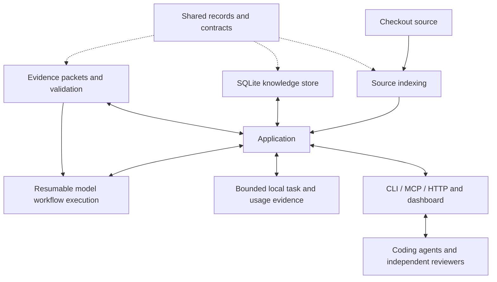

# AnaxiGraph V2 architecture

Help people and coding agents write better code, make sound architecture decisions, and leave the
next change straightforward.

## Selected direction — 25 October 2026

The maintainer selected a clean replacement in the standalone checkout `~/repos/anaxigraph-v2`.
Its Git history was extracted from the initial nested prototype on 25 October. This supersedes the
24 October recommendation to freeze all existing capabilities before comparing implementation
routes. Existing features are candidates, not mandatory migration obligations. Build the useful
minimum first and add features selectively. Fresh Eyes and pattern discovery remain core ideas.

The existing 0.9.1 implementation remains available separately. V2 imports none of its runtime.
The only copied product data is a compact selection of the existing 133 pattern cards; their old
scoring, planning and execution engines were not copied. The Apache license is retained. The
dashboard borrows visual direction, with a new small implementation.

## Eight components and one application

| Component | Provides | Must not own |
| --- | --- | --- |
| `contracts.py` | Immutable snapshot, node, edge and graph records | SQL, frameworks, source parsing or workflows |
| `indexing/` | `index(root) -> Graph`, incremental snapshot/source capture and bounded local Git history | Executing analyzed code, generating semantic prose or saving results |
| `storage/` | Atomic graph publication, canonical annotations, source indexes and bounded reviews | Architectural judgment, source parsing or provider execution |
| `analysis/` | Source/behavior evidence packets, complete-result validation and bounded guidance | SQL, UI, model-provider state or reading project files |
| `application/` | Shared facade, review operations and portable exchange; guard source/context identity and publish validated results | A separate store, parser, provider engine or transport-specific reasoning |
| `workflows/` | Durable batch scheduling, bounded provider execution, ordered review passes and retries | Source indexing, SQL, architectural reasoning outside the analysis contract |
| `evidence/` | Bounded local task, consultation, outcome and provider-usage records | Architectural reasoning, raw prompts/source, external telemetry or invented costs |
| `interfaces/` | CLI, MCP tools, HTTP and dashboard over the same application | Independent ownership inference or analysis state |

These are logical Python packages with explicit records and functions, installed together. Separate
distributions, services and plugin systems would add deployment work without helping this milestone.
The boundary tests make their dependency direction executable. Interfaces can evolve behind these
contracts without forcing their callers to know internal implementations.

## First milestone

1. Scan a checkout into a useful structural graph without a model call.
2. Inspect modules/functions, dependencies, consumers and observed test links.
3. Prepare a change using lexical/symbol/capability evidence; assess proposed file placement.
4. Pin a change baseline at preparation and compare subsequent candidates against it; attribute
   supplied check reports to the exact candidate.
5. Generate an annotation task with every supplied function and accept only complete results.
6. Cheaply screen catalogue IDs for production modules, then judge only shortlisted opportunities
   with ratings, costs, simpler alternatives and evidence. Retain exhaustive review as an opt-in.
7. Generate a behavior-only Fresh Eyes task retaining three independently described alternatives,
   complete declared requirement coverage, tradeoffs and high-level Mermaid diagrams.
8. Explore the same saved understanding through a sortable table, focused graph and review workflow.

The first milestone's external-agent request/submit interface remains available. The next selected
capability is an internal model runner: choose a provider/model per stage, independent parallel
batches, optional stronger fallbacks and ordered review passes. Each request is saved before work
starts. Accepted batches commit immediately. Run progress retains identities and status, rather than
another copy of source/results. Interrupted runs retry unfinished work; compatible accepted results
are reused only for the requested pipeline. Final reconciliation verifies module/catalogue coverage
or the blind product hierarchy. It is not an extra unverified claim that a review happened.

The [27 October focused-review decision](change-request-focused-reviews.md) sharpens this architecture:
a ten-principle charter favors explicit ownership, small public contracts and independently testable
components. Structural public-surface, private-reference, cycle and test-link observations inform
advice. Narrow Luna tasks map concisely and select plausible catalogue IDs; a stronger model judges
only those selections. Tests and inert markers remain mapped but leave the default pattern scope.
Screening is not evidence that every unselected pattern is irrelevant. Source-aware judgments remain
proposals, and required project checks remain authoritative. Existing explicit model profiles and
exhaustive results are preserved. Fresh Eyes stays independently requested.

The [component architecture principles](component-architecture-principles.md) define the intended
unit of independent development and verification: a cohesive component behind published behavioral
contracts, usually composed in process. Shared schemas, mutable state, configuration and infrastructure
can extend a change's scope even when signatures stay stable. Current guidance states these rules;
the bounded two-level reference neighborhood and observed test links are not a verified CI plan.
The [CI/CD workflow and declared-input planner](change-request-ci-delivery.md) now read real pipeline
declarations and select component checks from an authored task policy. The planner distinguishes
ordering prerequisites from consumed outputs, explains broadening and reports uncovered inputs.
It does not infer complete test ownership or execute the selected commands. Resource-aware impact
beyond those declarations and accepted component-rule editing remain proposed work.
The [architecture scouts](change-request-architecture-scouts.md) now perform focused source-aware
searches, compare local/workspace/separate-repository package options, feed task guidance and
require dispositions for material plan findings. They reuse the shared runner and do not alter
Fresh Eyes isolation. New Pattern runs also include a separate repository-level delivery specialist;
CI-only reviews need neither semantic annotations nor a Python application. The model proposes
pipeline improvements; deterministic check selection requires accepted task inputs in
`anaxigraph/ci-policy.json`. Both operate through the shared application and runner.

Annotation validity includes its own source and public interfaces of resolved outgoing dependencies.
Comment and body-only dependency edits preserve callers; changed signatures, documentation and
exports invalidate them. A separate implementation-change flag preserves behavioral uncertainty;
interface freshness never establishes behavior preservation.
An annotation contract version also controls reuse. This is not a guarantee of
complete dynamic-call invalidation. Stored annotations distinguish agent interpretations from
source observations; contracts distinguish declared evidence from inference. Reviews remain proposals.

## Fresh Eyes isolation

The returned blind request contains opaque requirement IDs, behavior statements, the source-independent
charter and the response contract. Source, module identities, symbols, dependency topology and prior recommendations are
excluded. Module IDs, source paths and code-shaped identities such as snake_case, CamelCase,
dotted/backticked names and calls are rejected. Ordinary English words remain usable. Functional statements
still require judgment: the validator cannot prove a sentence contains no conceptual implementation
assumption, that all product requirements were extracted, or that three descriptions are genuinely
different architectures.

Internal workers start in fresh temporary directories with tools, MCP connections, source rules and
prior sessions disabled. Give only the blind packet to an external worker without repository/source
tools; the server cannot sandbox an independently supplied agent's filesystem. Source-aware assessment of a
frozen alternative must remain a separate operation. Each level retains three alternatives rather
than declaring one tested or best. Subsystems produce behavior-only functional briefs with explicit
input-requirement attribution. Recursive groups of up to sixteen briefs feed independent product
designs. Final alternatives cover these product requirements without thousands of source IDs.
Coverage is checked mechanically; semantic preservation remains a model claim.

## State and bounds

- One local SQLite database per checkout by default: `.anaxigraph-v2/knowledge.sqlite`.
- Root identity is the exact resolved checkout. Linked worktrees do not share mutable analysis.
- Content, revision and analysis identity pin snapshots, including eligible untracked source.
- Current graph, one previous graph and one pinned change baseline; repeated unchanged scans do not
  append history. A new task or Git HEAD repins by default; explicit continuation preserves the pin.
- One canonical module annotation contains its sentence, paragraph, function sentences and contracts.
  Owner retrieval combines verified source, paths/symbols and current annotations at module level.
  The superseded FTS prose index is removed through a backed-up schema upgrade; source and
  annotation text is not copied into a second persistent search representation.
- Canonical node and interned-edge sets are compressed inside SQLite. Small source indexes support
  annotations/search. The application keeps at most one materialized current graph in memory;
  knowledge mutations from any process invalidate it. Request bookkeeping does not force a graph
  reload. Own annotation writes update cached modules only when no concurrent writer intervened.
- The default database ceiling is 100 MB. Writes fail atomically and preserve the last valid map.
  SQLite rollback journals are temporary; retained data is not an unbounded history archive.
- Compressed requests and current per-scope reviews live within the database budget. Current workflow
  batches are never discarded by a twenty-review cap; obsolete requests have bounded retention.
  Completed analyses survive graph-checkpoint pruning and disclose stale inputs.
  Writers coordinate across processes; readers remain concurrent. Compact failure diagnostics
  survive progress rotation in a bounded ledger exposed by workflow status.
- One `anaxigraph/record.json` carries canonical annotations, analyses and provenance through Git,
  without source, SQLite or deterministic graphs. Clone imports compare source, dependency and
  analysis input identities; product child identities are reconstructed in dependency order.
  Unknown model payload fields are excluded from saved result contracts.
- Portable publication targets 100 MB combined with active local state. Up to twelve workflow
  progress files have an aggregate 20 MB bound; retained-state writes enforce a 200 MB guard.
  Schema upgrades preserve one pre-migration backup. Failed writes preserve the last valid record.
- Ordinary lists are compact and paged. Source packets and explicit review/entity expansion are
  separate from list views; task/result size ceilings remain enforced.
  Task briefs preserve three owner candidates and essential contracts; their prose budget is
  soft. Historical co-change is separately attributed advice from the task baseline's Git history,
  never a dependency edge, a requirement to edit associated files, or authority to skip CI.

## Deliberate limits and next choices

Python/PYI is supported first. JavaScript/TypeScript are fingerprinted and explicitly unparsed.
Static resolution is incomplete for dynamic dispatch and frameworks; missing edges do not prove
dead code. No project code or project tests are executed by the service. Check results are
fingerprint-attributed agent/CI reports, not independently attested executions.

Portable records, internal worker pools and hierarchical blind design are selected extensions to the
first milestone, specified in [the change request](change-request-workflows.md). Legacy-format
result import, shared worktree bases, accepted architecture-rule editing, source-aware design
comparison and production deployment remain separate work. Unsupported portable formats are
preserved and rejected explicitly; they are never silently overwritten. The legacy database remains
untouched. The old feature list is not frozen.

## Packaging destination

Keep the existing PyPI project name `anaxigraph`. Develop V2 here as `1.0.0a1` in its own uv
environment and standalone GitHub repository. The legacy checkout and release workflow remain
separate at `hcekne/anaxigraph`. Moving the checkout does not publish a package or replace a service.

When the selected product is ready, update README/metadata/plugin commands, qualify migration and
installed-package behavior, and configure PyPI trusted publishing for this source repository before
publishing `anaxigraph==1.0.0`. Preserve the existing PyPI project and earlier releases; do not assume
its existing repository-bound publisher automatically authorizes a different GitHub repository.
Optional public prereleases can precede the final transition. See the
[Python version specification](https://packaging.python.org/en/latest/specifications/version-specifiers/).

## Evidence before adding complexity

Record cold/warm scan time, read latency, current bytes, repeated-cycle growth and real agent task
outcomes. Keep fixture correctness, actual browser/MCP integration, installed-wheel checks and
live model review distinct. A passing shape validator does not demonstrate better architectural
judgment. Add later-change evaluation before claiming the tool improves maintainability.
