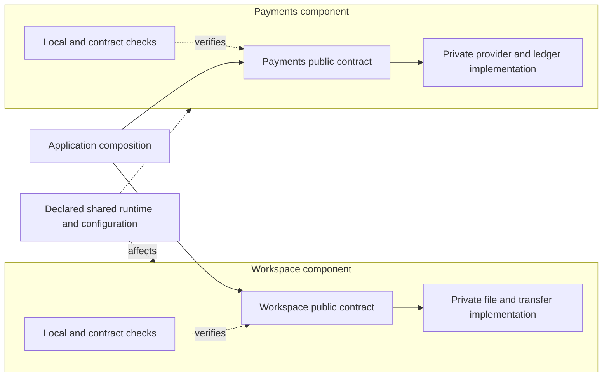

# Components as independent units of change — 27 October 2026

## Purpose and status

Help people and agents improve a large application without repeatedly understanding, changing and
testing the entire application. Favor cohesive components with small published contracts, private
implementation, explicit dependencies and local verification. Many agents should be able to improve
different components concurrently while preserving the agreements between them.

This records the maintainer's house analogy and sharpens the existing ten-principle charter.
The subsequent [architecture scout implementation](change-request-architecture-scouts.md) turns
these principles into mandatory focused jobs, including standalone libraries in separate repos,
and explicit dispositions during plan assessment.
The charter and agent change guidance express this policy. The subsequent scouts make focused
review jobs mandatory in new Pattern workflows. The subsequent
[CI/CD review and declared-input planner](change-request-ci-delivery.md) add a root pipeline review
to new Pattern runs and turn accepted task inputs into an explainable check plan. Full component
declarations and complete resource-aware impact analysis remain proposed capabilities below.
Neither review nor planning removes project CI checks or executes them.

## The house story

Imagine a house with 110 rooms. You replace the kitchen fan so cooking produces less smoke.
You check the fan and the kitchen's behavior. If its electrical and ventilation requirements remain
compatible, you should not need to redecorate the bedrooms or inspect every appliance in the house
before using it. Your change belongs to the kitchen, and its verification should largely belong
there too.

Now replace a roof shared by the kitchen, office and bedrooms. Those rooms can be affected even
though nobody changed their interiors. The sensible verification follows the rooms and services
that depend on that roof. A shared foundation or electrical supply can have a wider reach still.
The goal is to know that reach, rather than discovering it through failures or routinely inspecting
every room for every change.

Software should increasingly resemble connected small houses: each can be understood and improved
inside its own boundary, with clear doors and utility connections. A workspace engine can change
its file-transfer implementation while keeping its public behavior. A payments component can
improve its provider integration while preserving its callers' payment and failure guarantees.
An agent working inside one should not need to edit another component's internals.

The rooms may share one address. Likewise, components can live in one repository, run in one
process and ship as one application. A normal function or method call can connect them. Separate
servers, network protocols and deployments are choices for concrete needs, not prerequisites for
good boundaries.

A door that still fits is not the whole agreement. A replacement appliance that draws much more
power can affect other rooms. In software, unchanged function names and arguments do not prove
unchanged authorization, transactions, error behavior, data formats, latency or resource use.
The published contract must include the behavior other components actually rely on.

## Architectural vocabulary

The closest starting point is a **modular monolith**, with component-based design and enforced
package boundaries. A component is a coherent unit of responsibility and change; it can contain
several files, functions and classes. It need not be a separate distribution or a class.
Spring Modulith provides a concrete precedent: application modules expose an API, hide internal
implementation and declare the interfaces they require. Its verification checks cycles, access to
internals and optionally allowed dependencies. [Module fundamentals](https://docs.spring.io/spring-modulith/reference/fundamentals.html),
[structural verification](https://docs.spring.io/spring-modulith/reference/verification.html).

Independent development and verification do not imply independent deployment. A monorepo can
contain local packages, separately published libraries and deployable applications. Pick the
distribution and deployment arrangement that serves the product. Group responsibilities that
change together; avoid turning every helper into a package or every call into an interface.
Many consumers of a stable public contract can be healthy. Count dependencies to understand them,
not to require every component to have almost none.

## Policy for AnaxiGraph's advice

> Design software as cohesive components that people and agents can understand, change and verify
> independently. Each component owns a responsibility and its implementation, publishes a small
> behavioral contract and makes its dependencies explicit. Prefer in-process composition. Follow
> the actual effects of a change when choosing verification, including shared data and infrastructure.

Apply the existing charter as follows:

1. **Ownership:** give a coherent capability a clear owner. Reuse that owner before duplicating the
   capability. Extract a component when responsibilities need to evolve independently.
2. **Public surface:** publish the operations and types consumers need. Keep helpers private.
   A public API should represent useful capabilities, rather than expose the implementation layout.
3. **Contracts:** state observable behavior, errors, side effects, compatibility and relevant data
   or resource obligations. Back important guarantees with checks at the public boundary.
4. **Encapsulation:** other components use those contracts, including for owned data. A common
   database server is compatible with modularity; arbitrary cross-component table writes are not
   evidence of independent ownership. Shared tables and schemas need explicit agreements.
5. **Dependency direction:** declare allowed relationships and keep cycles visible. A common
   utility package should not become an unowned collection of business behavior everyone must know.
6. **Effects:** contain external providers, files, queues and persistence behind clear boundaries.
   Make shared state, configuration and environmental assumptions visible as dependencies too.
7. **Component tests:** provide a repeatable local verification target and public-contract checks.
   Use trustworthy substitutes for neighbors where useful; substitutes must agree with the real
   provider's contract. Keep focused integration checks for the important connections.
8. **Change locality:** let agents work in separate components against stable contracts. Coordinate
   contract changes and shared-resource changes explicitly; worktree isolation alone cannot prevent
   conflicting agreements. Recheck combined changes against their actual integration revision.
9. **Simplicity:** prefer cohesive packages and ordinary calls within a process. Use objects,
   functions, adapters or other catalogue patterns for demonstrated benefits. Separate services
   need a reason such as independent deployment, isolation or scaling that justifies their cost.
10. **Evidence and failure:** make the reason for the proposed verification scope inspectable.
    Record uncertainty and actual check results. A missing edge, unchanged signature or passing
    mock is not proof that consumers are unaffected.

These preferences guide judgment. They are not a quota for new packages, abstractions or tests.
Fresh Eyes receives the generic preferences alongside behavior-only requirements, never the
current component layout or this example's topology. It should still compare materially different
ways to satisfy the requirements.

## Integrations: common capabilities, private providers

An application with many integrations should add a provider through a small published agreement.
The host needs to discover available capabilities, understand their inputs and results, invoke an
authorized capability and handle its documented failures. Each provider owns its implementation.
Descriptions can include schemas, compatibility versions, required permissions, side effects and
retry or cancellation guarantees. Discovery must agree with the behavior actually delivered.
Typed capability payloads and explicit unsupported-operation responses keep a common invocation
envelope from turning into an unchecked dictionary or a growing switch on provider names.

API adapters and MCP adapters can share host-facing capability conventions while retaining their
different transport and lifecycle requirements. A common transport helper is justified by shared
behavior; it should not absorb every provider's business rules. An ordinary new provider should
not require edits throughout orchestration, authorization, unrelated providers and application UI.
Declarative registration and contract-level composition are useful when they remove that recurring
work. No particular class hierarchy, plugin framework or network service is mandatory.

Test the proposed independence by running a provider's checks without installing unrelated
providers or bootstrapping the whole application's database. Add consumer checks for the actual
host agreement, and verify important substitutes against the real adapter contract. A provider
that passes only when every other implementation is importable has an environmental dependency
even if its public method signature looks isolated.

Packaging still determines deployment scope. A provider shipped inside one application image may
have focused tests while requiring that application's image to be rebuilt and released. Independent
provider deployment requires a real artifact/runtime boundary, compatible host contracts and
release evidence. Choose that extra boundary when its maintenance or delivery benefits justify it.
One million integrations is a design-pressure question, not a reason to create one million services.

Use a few concrete questions at the relevant decision, rather than repeating a long checklist:

- Who owns this capability, and can a new provider fit without changing its consumers?
- What does the public contract promise about errors, authorization, state and side effects?
- If another thousand similar requests arrived, which shared files or checks would keep growing?
- Can this component be installed and verified with unrelated implementations unavailable?
- Which changed inputs justify the selected checks, and what uncertainty requires a broader scope?
- Which exact artifact was verified, which consumers need compatibility checks, and how is recovery
  handled if this release fails?

The [integration drift experiment](../experiments/drift/README.md) exercises these claims over a
sequence of changes. Executable behavioral checks decide correctness; review of actual boundaries
and subsequent changes decides whether the architecture improved. Naming a component or claiming
compatibility does not earn that conclusion.

## The component view

The useful high-level map should show responsibilities and public connections, with implementation
details available by expansion. This illustrative layout is a design example, not an observation
about FlowThink's source or a new dashboard capability:

Keep three related views distinct: source references explain implementation links; component
relationships describe architectural agreements; verification tasks describe which checks depend
on which inputs. A file is not automatically an architectural component, and a source dependency
does not automatically mean every consumer test needs to run on every edit.

## Verification should follow the change

| Change | Intended verification scope |
| --- | --- |
| Internal implementation with compatible behavior and no changed shared inputs | Component behavior and public-contract checks, plus the project's applicable integration/smoke requirements. Reuse unrelated results whose actual inputs remain compatible. |
| Public behavior, types, errors or provided contract | Component checks and relevant consumer contract/integration checks, following affected relationships as far as necessary. Coordinate incompatible changes. |
| Shared schema, mutable state, events, authorization or resource obligations | Checks for the owners and affected consumers of that shared agreement, including migrations or security behavior where relevant. |
| Shared runtime, build configuration, dependencies or deployment wiring | Checks for components and tasks using the changed infrastructure. A widely shared input can legitimately affect the entire application. |
| Unknown ownership, missing dependency evidence or unsupported language | State what is unknown, investigate the missing relationships and retain the established broader checks until there is a justified scope. |

The kitchen case earns a narrow scope through real isolation and contract verification. The roof
case earns a broader scope through shared dependencies. Neither is decided by directory names alone.
Preserving signatures is useful evidence, not permission to declare a behavior change harmless.

Make the fast feedback loop local. Run independent checks concurrently and reuse valid results.
Keep the system-level checks appropriate to the repository's release and assurance needs; use
scheduled or release suites where that is the project's chosen policy. Reduce unnecessary test
startup, duplicated checks and unrelated invalidation instead of deleting useful regression tests
to make a timing number smaller. Never quietly replace existing required checks with a heuristic.

There are established implementations to borrow from. Spring Modulith can bootstrap an individual
module for integration tests. Nx uses changed inputs and project relationships to select affected
tasks, with caching to avoid repeating compatible results; shared inputs and lock-file changes
can expand the scope. Python Import Linter can enforce protected imports, independence and
dependency direction. These are precedents, not new AnaxiGraph dependencies or implemented
integrations. [Module testing](https://docs.spring.io/spring-modulith/reference/testing.html),
[Nx affected tasks](https://nx.dev/docs/features/ci-features/affected),
[Import Linter contracts](https://import-linter.readthedocs.io/en/stable/contract_types/).

## What AnaxiGraph can say now

The current map observes public definitions, resolved private accesses, cycles and test references.
The shared charter informs pattern screening, selected detailed review and blind alternatives.
`prepare_change` and `assess_plan` expose the principles and local/consumer verification advice.
They now explicitly mention behavioral and shared-resource changes as reasons to widen checks.

These are advisory observations. The current impact neighborhood follows resolved reverse
references for **two levels**; its test list is not a complete test plan. Python globals, attributes,
dynamic dispatch, shared resources and unparsed languages can hide relationships. AnaxiGraph does
not yet declare architectural components, model all build inputs, run project tests or generate a
verified CI selection from the source graph. The separate `ci-plan` operation uses the repository's
authored `anaxigraph/ci-policy.json`: declared inputs, shared inputs, data consumers and retained
obligations determine its selection. Unknown ownership stays incomplete. The CI/CD workflow reads
actual pipeline declarations and reviews a fast path, widening, caching, parallelism and deployment
checks. It runs without semantic mapping and keeps missing timings and opaque scripts explicit.
Revisit that design after changes to components, shared inputs or delivery configuration.
A structural node without callers is not established dead code.

Guidance from structural facts and the charter is deterministic; running architecture and CI/CD
reviews uses the configured model workers. Neither requires rewriting an application into packages.
Changed charter text changes the inputs of future reviews that use it; saved results and provenance
remain available, but old-prompt results are not silently presented as new-prompt reviews. No full
re-analysis is started merely to publish this principle.

## Continue improving component change scope

The CI task policy now declares executable verification inputs. Extend it with a compact optional
declaration of meaningful components, reusing existing workspace,
package and test configuration where practical. This is a proposed metadata contract, not an
accepted new file format:

| Information | Purpose |
| --- | --- |
| Responsibility, owner and source roots | Identify the unit agents can work in. |
| Provided and required contracts; compatibility evidence | Distinguish internal work from changed agreements. |
| Owned and shared resources, schemas, configuration and effects | Expose the roof and utilities, including dependencies absent from imports. |
| Local build/test targets and contract/integration targets | Make independent verification executable. |
| Input versions, environment and provenance | Explain valid reuse and preserve unknowns. |

Combine those declarations with observed relationships. Before implementation, the tool should
answer: where does this change belong, what can stay private, what agreement must be preserved,
which local checks apply and what could extend the scope? Afterward it should explain selected
checks, affected consumers, compatible cached results and unresolved relationships. Declared
commands are instructions for an authorized runner; discovering them does not authorize the
mapping service to execute arbitrary project code.

A recommendation should name a concrete improvement and its cost: for example, prevent a caller
from reaching provider-specific storage, or give the transfer engine a small isolated test target.
It should explain how that improves the next change and what would verify the claim. A generic
instruction to apply microservices or add an interface is insufficient.

Build this in small steps: declared component ownership and public boundaries, resource-aware
dependency evidence, an explainable check plan, then integration with an existing task runner.
Do not build a second CI platform or prescribe one package manager to express the principle.
Measure local feedback time, selected and executed checks, cache reuse, missed regressions,
contract-change detection and concurrent-agent integration failures. Compare against broader
checks and subsequent development tasks before claiming equivalent assurance or faster delivery.
